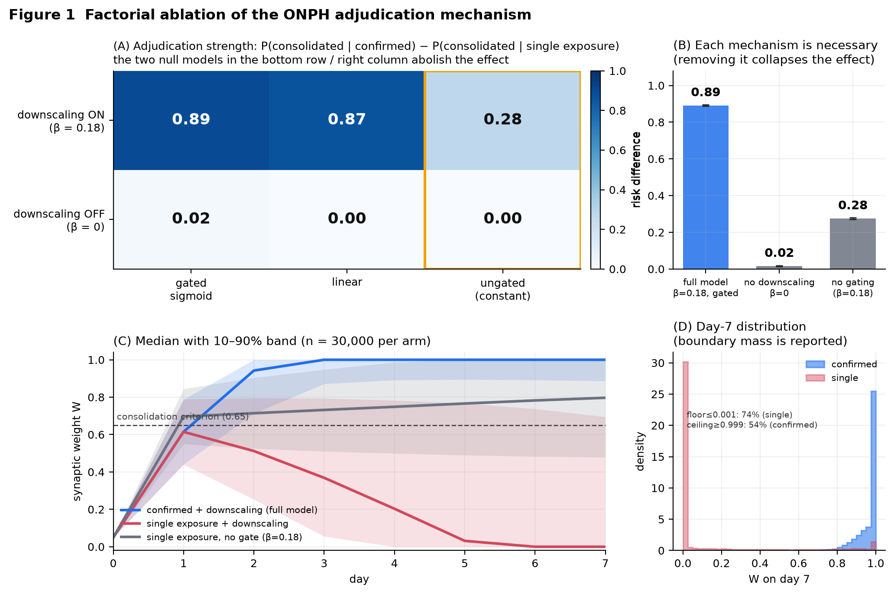
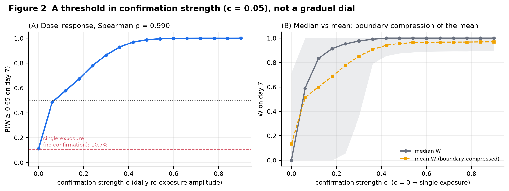
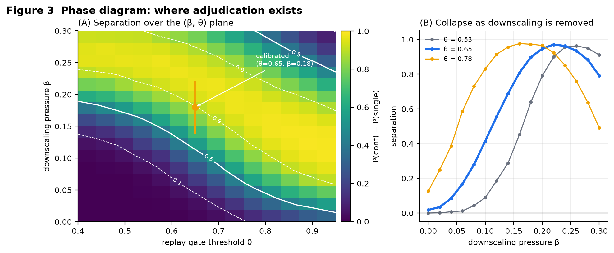
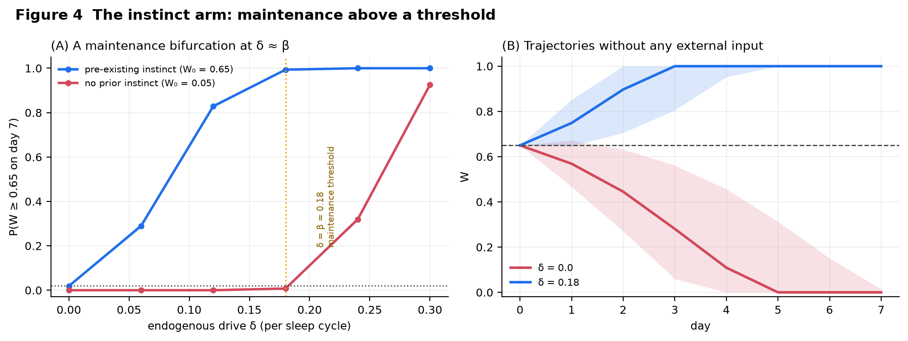
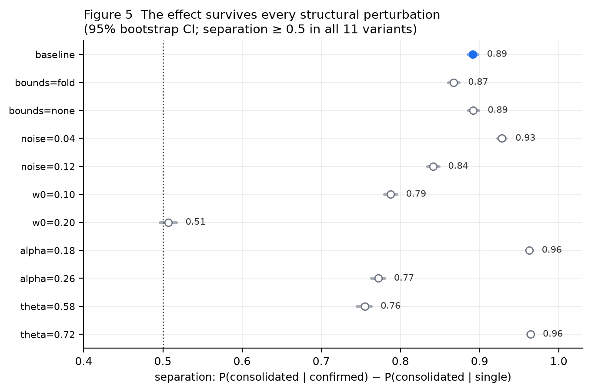

# ONPH: Offline Neural Plasticity Homeostasis Hypothesis
# 离线神经可塑性稳态假说 (ONPH)

[](https://creativecommons.org/licenses/by/4.0/)
[](https://doi.org/10.5281/zenodo.18132447)
[](https://www.python.org/)

ONPH proposes that sleep is not a passive rest state but an active, **bidirectional adjudication system** over synaptic weights: NREM/REM cycles consolidate memories that were confirmed during wake, prune unconfirmed traces through homeostatic downscaling, and protect phylogenetic memories (instincts) through endogenous drive.

ONPH 假说认为睡眠不是被动休息，而是一个对突触权重进行的**双向判定系统**：睡眠周期巩固在觉醒期被确认的记忆，通过稳态下调修剪未被确认的痕迹，并以内源驱动保护系统发生学记忆（本能）。

This repository contains the **computational model only**. The theoretical manuscript is distributed separately.

本仓库只包含**计算模型**。理论文稿另行发布。

---

## What this repository claims — and does not claim
## 本仓库主张什么、不主张什么

**Claims / 主张**

1. Under a discrete-time stochastic update rule with three mechanisms — wake confirmation, homeostatic downscaling, and a threshold-gated replay — the model produces a sharp divergence between confirmed and unconfirmed memories, **and each mechanism is individually necessary** for that divergence.
   在"觉醒确认 + 稳态下调 + 阈值门控重放"的离散随机更新规则下，模型能产生确认/未确认记忆之间的尖锐分化，且**每一项机制都是必要的**。

2. The effect occupies a bounded region of parameter space: downscaling pressure β has both a lower and an upper bound, beyond which the divergence collapses.
   该效应位于参数空间的一个有界区域：下调压力 β 存在上下界，越界则分化塌陷。

3. Instinct maintenance requires an endogenous drive no smaller than the downscaling pressure (δ ≈ β); above that threshold the instinct arm exhibits a self-sustaining, and a sufficiently strong drive can even bootstrap a weak trace.
   本能维持要求内源驱动不低于下调压力（δ ≈ β）；超过阈值后本能臂自持，且足够强的驱动甚至能把弱痕迹自举起来。

**Non-claims / 不主张**

- This is **not** empirical validation. Every number here is produced by a simulation with calibrated (not fitted) parameters.
  这**不是**经验验证。所有数字都来自校准参数（非拟合）下的仿真。
- It does **not** show that sleep *is* a bidirectional adjudication system. It shows that a system obeying this rule *would* display the proposed dynamics; alternative rules producing the same dynamics are not excluded.
  它**不**证明睡眠就是双向判定系统。它只说明：遵循该规则的**系统会**呈现所提出的动力学；产生同样动力学的其他规则未被排除。

---

## Quick start / 快速开始

```bash
pip install -r requirements.txt
python -m src.experiments   # 3,032,000 Monte Carlo trajectories -> results/
python -m src.figures       # Figures 1-5 -> figures/
```

Runtime ≈ 11 s on a laptop CPU; all seeds are fixed (`BASE_SEED = 2026`).

---

## The model / 模型

Discrete-time stochastic **difference** equation (not an SDE), one iteration per wake–sleep cycle:

```
u_t     = 0.9                              (t = 1, encoding)
        = c · exp(-0.2 (t-1))              (t ≥ 2, confirmation strength c)
w_wake  = B( w_{t-1} + γ u_t )
g       = σ(κ (w_wake - θ))                (replay gate; κ = 12, θ = 0.65)
r_t     = g · N(0.9, 0.2)                  (replay)
s_t     = N(1.0, 0.05)                     (homeostatic downscaling)
w_t     = B( w_wake + α r_t - β s_t + δ·I + N(0, 0.08) )
```

with α = 0.22, β = 0.18, γ = 0.70, δ = 0.18. `B` is a boundary operator: hard clip (default), reflecting fold, or identity (robustness control). All arms start from the same weight, W₀ = 0.05.

Three mechanisms, four switches: confirmation strength `c`, downscaling `beta`, replay gating `{sigmoid, linear, none}`, endogenous drive `delta`. Every mechanism can be switched off independently — which is what makes the simulation falsifiable.

---

## Results / 结果

Full run: **3.03 million trajectories** across five experiment families (`docs/validation_zh.md` for the complete report).

### 1. Factorial ablation: the divergence comes from the sleep mechanisms, not from the input schedule

| β | replay gating | risk difference P(confirmed) − P(single) | 95% CI |
|---|---|---|---|
| **0.18** | **sigmoid** | **0.892** | [0.888, 0.895] |
| 0.18 | none (constant) | 0.276 | [0.271, 0.281] |
| 0.00 | sigmoid | 0.016 | [0.015, 0.018] |
| 0.00 | none | **0.000** | — |

Removing downscaling collapses the separation from 0.892 to 0.016; removing the gate lets 72% of unconfirmed traces survive instead of 11%; removing both gives exactly zero. The same input difference produces **no** divergence when the sleep machinery is off — this is the control that v1 of this repository lacked.



### 2. Confirmation strength acts as a threshold (c ≈ 0.05), and the dose–response is monotone (Spearman ρ = 0.990)

Single exposure without confirmation retains 11% of memories; c = 0.12 already pushes 58% past the criterion; the calibrated c = 0.6 sits on the saturated plateau, not on the cliff edge.



### 3. Phase diagram: a finite window in (β, θ)

Separation is non-monotone in downscaling pressure — it peaks near β = 0.22 and falls again above β = 0.24, because excessive downscaling also erodes confirmed memories. 81% of the 448 (β, θ) cells show separation > 0.1; the calibrated point lies inside the plateau, not on an edge.



### 4. Instinct arm: maintenance with a threshold at δ ≈ β

With no external input at all, a pre-existing instinct (W₀ = 0.65) survives on day 7 in 1.9% of trajectories at δ = 0, 82.9% at δ = 0.12 and 99.4% at δ = 0.18. Above the threshold the arm is self-sustaining, and δ = 0.30 can bootstrap a trace that started at W₀ = 0.05 (92.6%) — a refinement of the original "maintain, never create" phrasing.



### 5. Robustness: separation ≥ 0.51 across 11 structural perturbations

Boundary rule, noise level, replay gain and gate threshold barely matter. The one substantive sensitivity is the initial weight: raising W₀ from 0.05 to 0.20 halves the effect (0.892 → 0.507), which is exactly the confound that the earlier single-scenario design could not detect.



---

## Repository layout / 目录结构

```
src/model.py          discrete-time update rule with orthogonal mechanism switches
src/experiments.py    E1-E5 experiment families, writes results/
src/figures.py        Figures 1-5, writes figures/
src/stats_utils.py    Wilson / bootstrap / Cohen's d / overlap (no pseudo-replicated ANOVA)
results/              machine-readable outputs (CSV + day-7 weights + summary.json)
figures/              rendered figures
docs/validation_zh.md full validation report (Chinese), incl. pre-registered falsification conditions
archive_v1/           the previous single-script version, kept for provenance
```

## Statistics / 统计口径

The primary endpoint is **P(W_day7 ≥ 0.65)** — a binary outcome that is robust to the boundary clipping of W. Reported alongside: median, 10/90 quantiles, and the fraction of trajectories pinned to 0 and to 1. Group contrasts use risk differences with bootstrap confidence intervals, Cohen's d and histogram overlap. Monte Carlo replicates are **not** biological samples; no ANOVA p-values are used as evidence.

主终点是 **P(W_day7 ≥ 0.65)** 这一对截断稳健的二分结局，同时报告中位数、10/90 分位与贴顶/贴底比例。组间对比使用风险差 + bootstrap 置信区间、Cohen's d 与直方图重叠系数。蒙特卡洛重复**不是**生物样本，因此不使用方差分析的 p 值作为证据。

## Data availability / 数据

All data in this repository are **model-generated**, not empirical. `results/e1_day7.npz` stores the day-7 weights of the 12 factorial arms (n = 30,000 each); the remaining experiments store per-arm summary statistics. Regenerate everything with the two commands above.

本仓库所有数据均为**模型生成**，非实测数据。运行上述两条命令即可完整复现。

## License

CC BY 4.0 — see [LICENSE](LICENSE).
