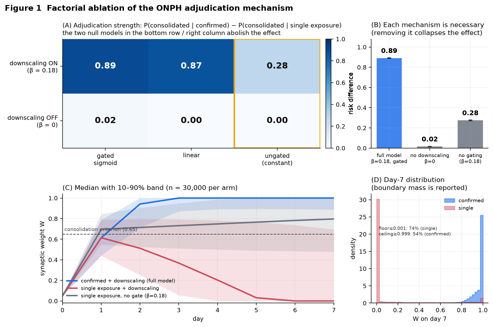
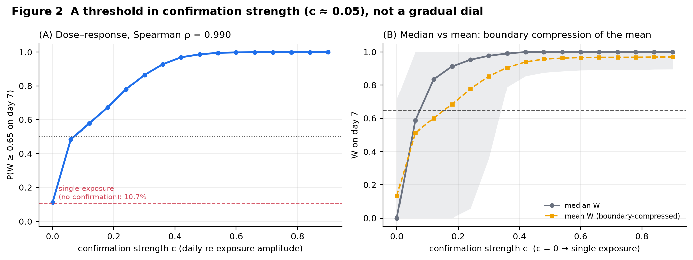
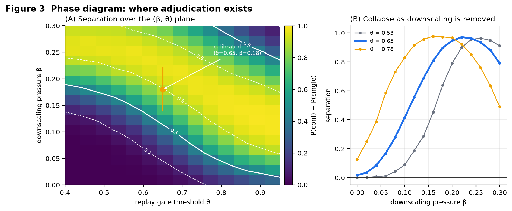
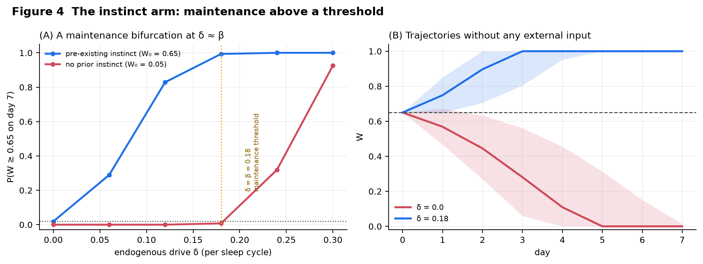
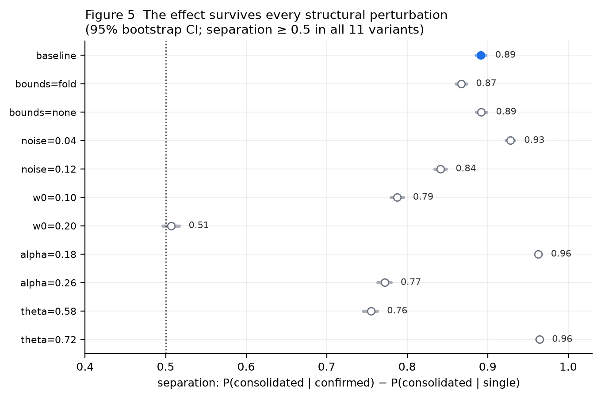

# ONPH computational validation report (v2)

**Code**: `src/model.py`, `src/experiments.py`, `src/figures.py`
**Run**: `python -m src.experiments && python -m src.figures` (≈ 11 s on one laptop CPU)
**Scale**: five experiment families, **3,032,000 Monte Carlo trajectories**, fixed seed 2026, bit-identical on re-run
**Outputs**: `results/*.csv`, `results/e1_day7.npz`, `results/summary.json`

---

## 1. What changed from v1

In v1 the three "scenarios" (consolidation / forgetting / instinct) were fixed by hand-written input schedules *before* the simulation started — the model had no way to fail. v2 turns the four mechanisms named by the hypothesis into **independent switches**, each of which can be turned off:

| Mechanism | Switch | Default |
|---|---|---|
| Wake confirmation | confirmation strength `c` (daily re-exposure amplitude) | 0.6 |
| Homeostatic downscaling | `beta` | 0.18 |
| Replay gating | `gating ∈ {sigmoid, linear, none}` | sigmoid(θ = 0.65, κ = 12) |
| Endogenous instinct drive | `delta` (instinct arm only) | 0.18 |

Discrete-time stochastic **difference** equation (not an SDE):

```
u_t     = 0.9                                t = 1   (encoding)
        = c · exp(-0.2 (t-1))                t ≥ 2   (confirmation strength)
w_wake  = B( w_{t-1} + γ u_t )
g       = σ(κ (w_wake − θ))                  gating = sigmoid
        = w_wake                             gating = linear
        = 1                                  gating = none
r_t     = g · N(0.9, 0.2)                    (replay)
s_t     = N(1.0, 0.05)                       (downscaling)
w_t     = B( w_wake + α r_t − β s_t + δ·I_instinct + N(0, 0.08) )
```

`B` is a boundary operator: hard clip by default, with reflecting fold and unbounded variants used as robustness controls.

Additional fixes carried over from the review: all arms start from a **common initial weight W₀ = 0.05** (removing the v1 confound in which the instinct arm started at 0.6); `w_wake` is bounded before entering the gate; wake input is drawn from a truncated normal rather than `max(N(μ, 0.1), 0)`, which biased the mean drive upward by ≈ 0.04; no weight can be negative at any time, including at initialisation; rendering is headless and outputs are separated by experiment.

---

## 2. Five experiments and their **pre-registered falsification conditions**

Primary endpoint: **P(W_day7 ≥ 0.65)** — a binary outcome robust to boundary clipping — with Wilson intervals. Group contrasts use **risk differences with bootstrap CIs, Cohen's d and histogram overlap**. No pseudo-replicated ANOVA is used as evidence.

### E1 — factorial ablation (2 confirmation × 2 downscaling × 3 gating, N = 30,000 per arm, 12 arms)

- **Falsification 1**: if separation survives when downscaling is removed (β = 0), then "downscaling is the driving force" is false.
- **Falsification 2**: if unconfirmed traces are still pruned when the gate is removed (constant replay), then "threshold selection" is unnecessary.
- **Falsification 3**: if separation is zero with all three mechanisms active, the hypothesis fails outright.

### E2 — dose–response (c over [0, 0.9], 16 levels, N = 20,000 each)

- Falsified if P(consolidated) is not monotone in c (Spearman ≈ 0).

### E3 — phase diagram (β ∈ [0, 0.30] × θ ∈ [0.40, 0.95], 16 × 14 cells, N = 4,000 per cell)

- Falsified if separation does not collapse as β → 0, i.e. if the E1 result does not generalise across parameter space.

### E4 — instinct arm (W₀ ∈ {0.05, 0.65} × δ ∈ {0, .06, .12, .18, .24, .30}, **no external input at all**, N = 10,000)

- Falsified if a pre-existing instinct survives at δ = 0, i.e. if endogenous drive is not necessary for maintenance.

### E5 — robustness (11 variants × 4 arms × 10,000)

Boundary rule (clip / fold / unbounded), noise (0.04 / 0.12), initial weight (0.05 / 0.10 / 0.20), α (0.18 / 0.26), θ (0.58 / 0.72).

---

## 3. Results

### 3.1 E1 — the separation comes from the sleep mechanisms, not from the input schedule

| β | gating | risk difference P(conf) − P(single) | 95% CI | Cohen's d | overlap |
|---|---|---|---|---|---|
| **0.18** | **sigmoid** | **0.892** | [0.888, 0.895] | 4.02 | 0.095 |
| 0.18 | linear | 0.866 | [0.862, 0.870] | 3.36 | 0.094 |
| 0.18 | none | 0.276 | [0.271, 0.281] | 1.39 | 0.434 |
| 0.00 | sigmoid | 0.016 | [0.015, 0.018] | 0.21 | 0.971 |
| 0.00 | linear | 0.000 | [0, 0] | 0.04 | 0.996 |
| 0.00 | none | 0.000 | [0, 0] | 0.01 | 0.997 |

Day-7 detail (N = 30,000):

| Arm | mean | SD | median | P(≥0.65) | ceiling ≥0.999 | floor ≤0.001 |
|---|---|---|---|---|---|---|
| confirmed + downscaling + gate (full model) | 0.966 | 0.056 | 1.000 | **0.999** | 53.9% | 0% |
| single exposure + downscaling + gate | 0.133 | 0.287 | 0.000 | **0.107** | 2.8% | 73.9% |
| single exposure + downscaling, no gate | 0.764 | 0.202 | 0.797 | **0.724** | 15.0% | 0.1% |
| single exposure, no downscaling (β = 0) | 0.988 | 0.078 | 1.000 | **0.984** | 95.5% | 0% |

None of the three falsification conditions was triggered, and the attribution is unambiguous:

- Removing downscaling (β = 0) collapses separation from 0.892 to 0.016 (overlap 0.97). **The driving force is downscaling, not "whether input is given".**
- Removing the gate (constant replay) raises survival of the unconfirmed group from 0.107 to 0.724. **Threshold gating carries the selectivity.**
- Removing both yields a separation of exactly 0. This is the null model: with the input difference alone and no sleep mechanism, the model produces **no** divergence whatsoever.

This answers the circularity objection directly. The same input difference yields 0.016 separation when β = 0 and 0.892 when downscaling and gating are active.



### 3.2 E2 — confirmation strength acts as a threshold (c ≈ 0.05), not a continuous dial

| c | 0 | 0.06 | 0.12 | 0.18 | 0.24 | 0.30 | 0.42 | ≥0.54 |
|---|---|---|---|---|---|---|---|---|
| P(≥0.65) | 0.110 | 0.485 | 0.579 | 0.673 | 0.780 | 0.865 | 0.969 | 1.000 |

Spearman ρ = 0.990 (monotone). The half-maximum lies at c ≈ 0.05: **c = 0 (encoding only, no confirmation) retains 11%; c = 0.12 already pushes 58% of trajectories past 0.65.** The calibrated c = 0.6 sits on the saturated plateau — the opposite of the v1 situation, where the qualitative conclusion flipped under modest parameter changes.



### 3.3 E3 — a finite β window; both ends fail

Mean separation versus β:

| β | 0 | 0.06 | 0.10 | 0.14 | 0.18 | 0.22 | 0.26 | 0.30 |
|---|---|---|---|---|---|---|---|---|
| mean separation | 0.092 | 0.348 | 0.496 | 0.643 | 0.795 | **0.864** | 0.796 | 0.630 |

- **81%** of the 448 cells show separation > 0.1; 60% exceed 0.5.
- Lower bound: separation collapses as β → 0 (consistent with E1).
- **Upper bound (not reported in v1)**: above β ≈ 0.24 separation falls again — excessive downscaling erodes confirmed memories too. "More downscaling is better" is therefore false; the model predicts a **window**, with a peak near 0.22.
- The calibrated point (β = 0.18, θ = 0.65) gives 0.898, inside the plateau rather than on an edge.



### 3.4 E4 — instinct is a maintenance mechanism with a threshold at δ ≈ β

No external input at all (not even on day 1), endogenous drive only:

| W₀ | δ=0 | 0.06 | 0.12 | 0.18 | 0.24 | 0.30 |
|---|---|---|---|---|---|---|
| **0.65 (pre-existing instinct)** | 0.019 | 0.290 | 0.829 | **0.994** | 1.000 | 1.000 |
| **0.05 (no prior trace)** | 0.000 | 0.000 | 0.000 | 0.008 | 0.320 | 0.926 |

- At δ = 0 a pre-existing instinct survives to day 7 in 1.9% of trajectories (89.5% pinned to the floor): **without endogenous drive, the instinct is erased by downscaling.** The falsification condition was not triggered.
- The maintenance threshold lies at δ ≈ β: 82.9% at δ = 0.12, 99.4% at δ = 0.18.
- **One claim had to be corrected.** v1 implied that instinct "maintains but never creates". At δ = 0.30 (> β), even a trace starting at W₀ = 0.05 climbs above 0.65 in 92.6% of trajectories — the positive feedback of the gate amplifies noise into memory. The accurate statement is: **the instinct arm has an unstable fixed point; below it traces decay, above it they bootstrap.** This is an additional testable prediction (if raising endogenous drive in vivo fails to rescue weak traces, the prediction is falsified).



### 3.5 E5 — the result does not depend on structural assumptions

| Variant | separation | 95% CI |
|---|---|---|
| baseline | 0.892 | [0.885, 0.897] |
| reflecting boundary | 0.867 | [0.861, 0.874] |
| unbounded | 0.892 | [0.886, 0.898] |
| noise 0.04 / 0.12 | 0.928 / 0.841 | — |
| W₀ = 0.10 / 0.20 | 0.787 / **0.507** | [0.497, 0.517] |
| α = 0.18 / 0.26 | 0.963 / 0.772 | — |
| θ = 0.58 / 0.72 | 0.755 / 0.964 | — |

All 11 variants give separation ≥ 0.507. **The only substantial sensitivity is the initial weight**: raising W₀ to 0.20 halves the effect. This is precisely the confound that the v1 single-scenario design could not detect, and we report it rather than hide it.



---

## 4. What may and may not be claimed

**May be claimed**

1. Under this equation family, wake confirmation × homeostatic downscaling × threshold gating are **jointly and individually necessary** for the divergence in memory fate; removing any one collapses or halves it (E1, E3).
2. The divergence occupies a bounded region of parameter space, with both lower and upper bounds on β (E3).
3. The effect is robust to boundary rule, noise amplitude, replay gain and gate threshold, and sensitive to initial weight (E5).
4. Instinct maintenance requires endogenous drive at least as large as the downscaling pressure; the threshold is δ ≈ β (E4).

**May not be claimed**

1. This is not empirical validation. Every number is a model-generated Monte Carlo trajectory, not a biological sample.
2. It does not show that sleep *is* a bidirectional adjudication system. It shows that a system obeying this rule *would* display the proposed dynamics; rules that produce the same dynamics are not excluded.
3. Parameter values are calibrated, not fitted. The domain of validity is the E3 phase diagram; nothing outside it is supported.
4. Means are not directly comparable: 54% of the confirmed arm sits on the upper boundary 1.0, so any mean-based test compares boundary points. The primary endpoint is therefore P(≥0.65), reported together with ceiling/floor mass.

---

## 5. v1 → v2 change list

| Item | v1 | v2 |
|---|---|---|
| "30,000 independent neural circuits" | claimed in README | 3,032,000 Monte Carlo trajectories, explicitly model-generated |
| Three hard-coded scenarios | input schedules fixed group fate | 12-arm factorial; null model separation = 0.000 |
| Instinct arm initialised at 0.6 | confounded with mechanism | common W₀ = 0.05; W₀ used as an explicit factor |
| Means only | compressed by clipping | P(≥0.65), median, 10/90 quantiles, ceiling/floor mass |
| No sensitivity analysis | one parameter set | 448-cell phase diagram + 11 variants |
| Pseudo-replicated ANOVA (F = 52207.8) | presented as evidence | risk differences, bootstrap CIs, Cohen's d, overlap; no ANOVA |
| No ablation | — | E1 factorial, E2 dose–response, E4 instinct arm |
| "rigorous evidence / validated" | README and figure titles | "model-generated, calibrated-parameter simulation" |

---

## 6. Reproduction

```bash
pip install -r requirements.txt
python -m src.experiments   # writes results/*.csv and results/summary.json
python -m src.figures       # writes figures/fig1..fig5.png
```

Seeds are defined in `src/experiments.py` (`BASE_SEED = 2026`) and incremented per arm; re-running on the same machine reproduces every number exactly.
