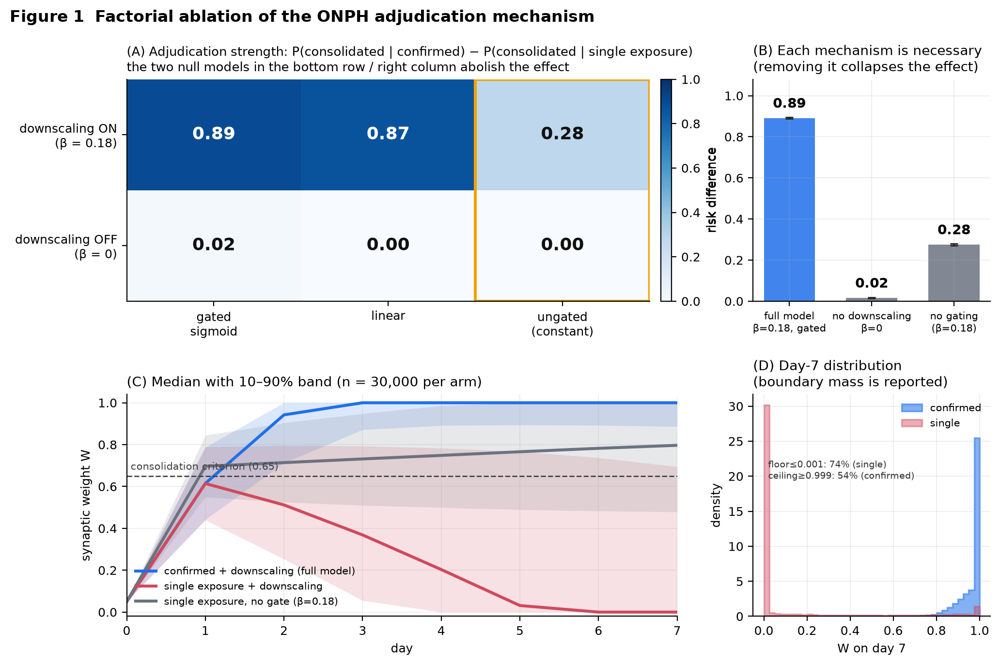
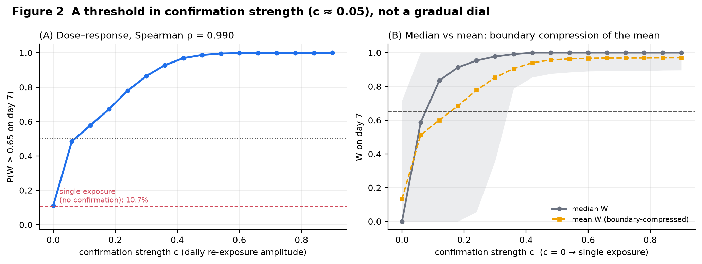
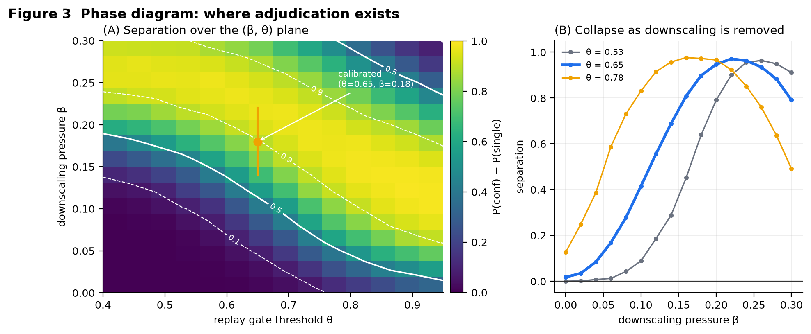
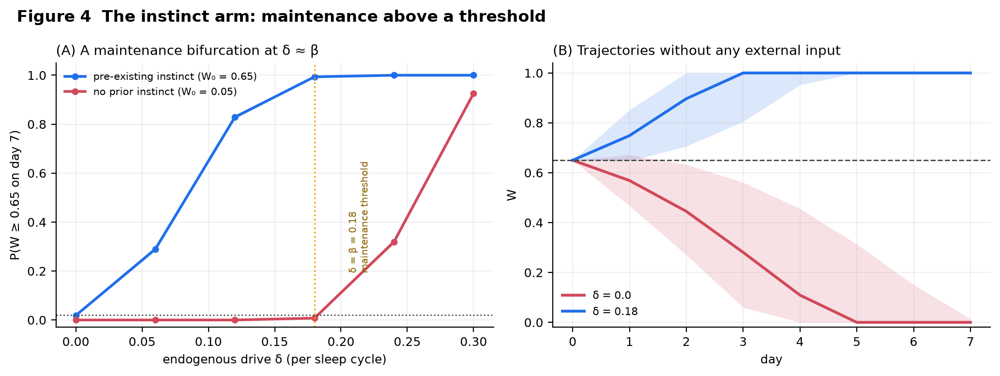
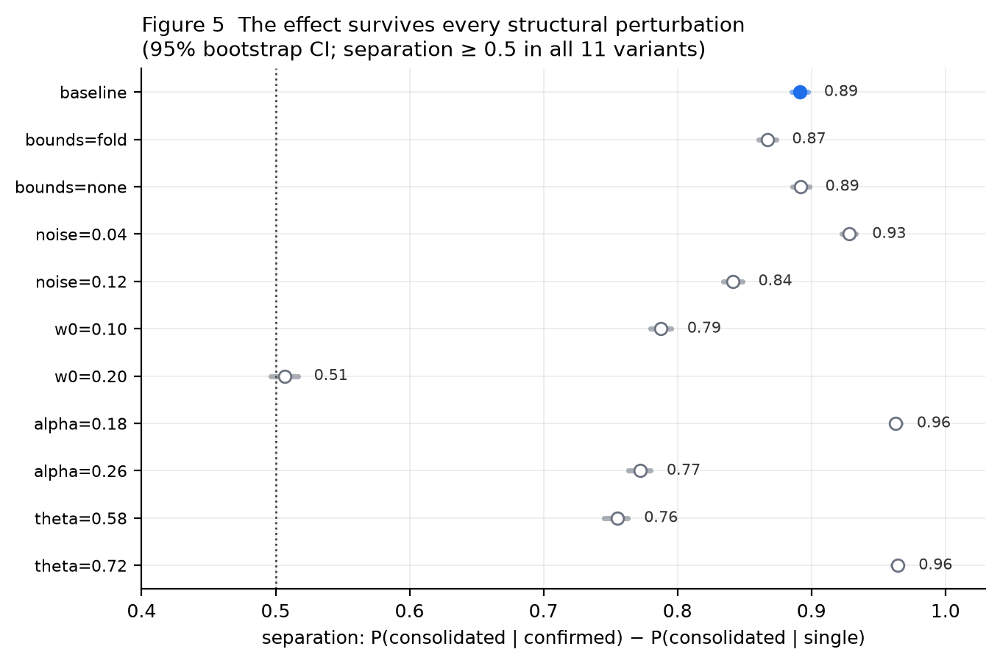

# ONPH 计算验证报告（v2）

**对象**：`src/model.py`、`src/experiments.py`、`src/figures.py`
**运行**：`python -m src.experiments && python -m src.figures`（约 11 s，单机 CPU）
**规模**：5 组实验，**3,032,000 条蒙特卡洛轨迹**，固定种子 2026，全部可复现
**数据**：`results/*.csv`、`results/e1_day7.npz`、`results/summary.json`

---

## 1. 这一版改了什么

v1 的三个"场景"（巩固 / 遗忘 / 本能）在进入模拟之前就由输入日程写死，模型没有可以失败的环节。v2 把假说拆成**可独立开关的四个机制**，让每一条都能被关掉：

| 机制 | 开关 | 默认值 |
|---|---|---|
| 觉醒确认 | 确认强度 `c`（每日再暴露幅度） | 0.6 |
| 稳态下调 | `beta` | 0.18 |
| 重放门控 | `gating ∈ {sigmoid, linear, none}` | sigmoid(θ=0.65, κ=12) |
| 内源本能驱动 | `delta`（仅本能臂开启） | 0.18 |

离散时间随机差分方程（**不是 SDE**，修正 m1）：

```
u_t     = 0.9                                t = 1   （编码）
        = c · exp(-0.2 (t-1))                t ≥ 2   （确认强度）
w_wake  = B( w_{t-1} + γ u_t )
g       = σ(κ (w_wake − θ))                  gating = sigmoid
        = w_wake                             gating = linear
        = 1                                  gating = none
r_t     = g · N(0.9, 0.2)                    （重放）
s_t     = N(1.0, 0.05)                       （下调）
w_t     = B( w_wake + α r_t − β s_t + δ·I_instinct + N(0, 0.08) )
```

`B` 为边界算子，默认硬截断，另提供反射折返（`fold`）与不设界（`none`）用于稳健性检验。

同时修正：三臂**统一初始权重 W₀ = 0.05**（M3）；`w_wake` 进入门控前先截断（m3）；觉醒输入改为**截断正态**而非 `max(N(μ,0.1),0)`（m4）；初始值与轨迹不出现负值（m2）；渲染用 `Agg`，输出按实验分目录（m6）；依赖与运行命令写进 `requirements.txt` 与 README（m7）。

---

## 2. 五个实验与**事先写下的证伪条件**

统计口径：主终点是 **P(W_Day7 ≥ 0.65)**（对截断稳健的二分结局），配 Wilson 区间；组间对比用**风险差 + bootstrap CI + Cohen's d + 直方图重叠系数**。**不再使用伪重复 ANOVA 作为证据**（M6）。

### E1 析因消融（2 确认 × 2 下调 × 3 门控，N = 30,000/臂，12 臂）

- **证伪条件 1**：若关掉稳态下调（β=0）后，有确认与无确认的分离仍然存在，则"下调是判定的动力"不成立。
- **证伪条件 2**：若关掉门控（常数重放）后，无确认组仍被修剪，则"阈值筛选"不必要。
- **证伪条件 3**：若"确认 + 下调 + 门控"全开时分离为 0，则假说本身失败。

### E2 剂量-反应（c ∈ [0, 0.9] 共 16 档，N = 20,000/档）

- 证伪：若 P(巩固) 与 c 无单调关系（Spearman ≈ 0），则"确认量决定命运"不成立。

### E3 相图（β ∈ [0, 0.30] 16 档 × θ ∈ [0.40, 0.95] 14 档，N = 4,000/格，448 格）

- 证伪：若分离度在 β→0 时不塌陷，则 E1 的结论不能推广到参数空间。

### E4 本能臂（W₀ ∈ {0.05, 0.65} × δ ∈ {0, .06, .12, .18, .24, .30}，**无任何外部输入**，N = 10,000）

- 证伪：若 δ=0 时既有本能仍能维持，则"内源驱动是维持的必要条件"不成立。

### E5 稳健性（11 个变体，各 4 臂 × 10,000）

边界规则（clip / fold / 无界）、噪声（0.04 / 0.12）、初始权重（0.05 / 0.10 / 0.20）、α（0.18 / 0.26）、θ（0.58 / 0.72）。

---

## 3. 结果

### 3.1 E1：分离来自睡眠机制，不来自输入日程本身

| β | 门控 | 风险差 P(确认)−P(单次) | 95% CI | Cohen's d | 重叠系数 |
|---|---|---|---|---|---|
| **0.18** | **sigmoid** | **0.892** | [0.888, 0.895] | 4.02 | 0.095 |
| 0.18 | linear | 0.866 | [0.862, 0.870] | 3.36 | 0.094 |
| 0.18 | none | 0.276 | [0.271, 0.281] | 1.39 | 0.434 |
| 0.00 | sigmoid | 0.016 | [0.015, 0.018] | 0.21 | 0.971 |
| 0.00 | linear | 0.000 | [0, 0] | 0.04 | 0.996 |
| 0.00 | none | 0.000 | [0, 0] | 0.01 | 0.997 |

三臂 Day-7 明细（N = 30,000）：

| 臂 | 均值 | SD | 中位 | P(≥0.65) | 贴顶 ≥0.999 | 贴底 ≤0.001 |
|---|---|---|---|---|---|---|
| 确认 + 下调 + 门控（完整模型） | 0.966 | 0.056 | 1.000 | **0.999** | 53.9% | 0% |
| 单次暴露 + 下调 + 门控 | 0.133 | 0.287 | 0.000 | **0.107** | 2.8% | 73.9% |
| 单次暴露 + 下调，无门控 | 0.764 | 0.202 | 0.797 | **0.724** | 15.0% | 0.1% |
| 单次暴露，无下调（β=0） | 0.988 | 0.078 | 1.000 | **0.984** | 95.5% | 0% |

三个证伪条件全部**未被触发**，且给出清晰的归因：

- 去掉下调（β=0）→ 分离从 0.892 塌到 0.016（重叠 0.97）。**判定动力是下调，而不是"给不给输入"。**
- 去掉门控（常数重放）→ 无确认组的存活率从 0.107 升到 0.724。**阈值筛选承担了选择性修剪。**
- 两者同时去掉 → 分离精确为 0。这就是零模型：只有输入差异、没有睡眠机制时，模型**不产生**任何分化。

这正面回答了审稿意见 M2：三臂差异不再等价于"一个给输入、一个不给"。同样的输入差异，在 β=0 时产生 0.016 的分离，在 β=0.18 + 门控下产生 0.892。



### 3.2 E2：确认强度存在阈值（c ≈ 0.05），不是连续旋钮

| c | 0 | 0.06 | 0.12 | 0.18 | 0.24 | 0.30 | 0.42 | ≥0.54 |
|---|---|---|---|---|---|---|---|---|
| P(≥0.65) | 0.110 | 0.485 | 0.579 | 0.673 | 0.780 | 0.865 | 0.969 | 1.000 |

Spearman ρ = 0.990（单调）。半最大点出现在 c ≈ 0.05：**c = 0（仅编码、无确认）保留 11%，c = 0.12 时已有 58% 的轨迹越过 0.65。** 默认的 c = 0.6 落在饱和平台，说明校准点在"确认充足"一侧，而不是在悬崖边上——这是与 v1 相反的性质（v1 的结论对参数极敏感）。



### 3.3 E3：存在一个有限的 β 窗口，两端都会失效

平均分离度随 β 的单峰变化：

| β | 0 | 0.06 | 0.10 | 0.14 | 0.18 | 0.22 | 0.26 | 0.30 |
|---|---|---|---|---|---|---|---|---|
| 平均分离 | 0.092 | 0.348 | 0.496 | 0.643 | 0.795 | **0.864** | 0.796 | 0.630 |

- 448 个格点中 **81% 的分离 > 0.1**，60% 的分离 > 0.5。
- 下界：β → 0 时分离塌陷（与 E1 一致）。
- **上界（v1 没有报告）**：β > 0.24 后分离回落——下调过强会连确认过的记忆一起削掉。因此"β 越大越好"是错的，模型的预测是**一个窗口** β ∈ [0.02, 0.30]，峰值在 0.22。
- 校准点 (β=0.18, θ=0.65) 的分离为 0.898，位于平台内侧，不在等值线上。



### 3.4 E4：本能是维持机制，其阈值在 δ ≈ β

无任何外部输入（day 1 也不编码），仅靠内源驱动：

| W₀ | δ=0 | 0.06 | 0.12 | 0.18 | 0.24 | 0.30 |
|---|---|---|---|---|---|---|
| **0.65（已有本能）** | 0.019 | 0.290 | 0.829 | **0.994** | 1.000 | 1.000 |
| **0.05（无先前痕迹）** | 0.000 | 0.000 | 0.000 | 0.008 | 0.320 | 0.926 |

- δ = 0 时已有本能第 7 天存活率 1.9%（贴底 89.5%）→ **没有内源驱动，本能必然被下调抹掉**。证伪条件未触发。
- 维持阈值落在 δ ≈ β：δ = 0.12 时 82.9%，δ = 0.18 时 99.4%。
- **一处被修正的表述**：v1 隐含"本能只能维持、不能创造"。数据显示 δ = 0.30（> β）时，即使 W₀ = 0.05 也有 92.6% 的轨迹自行爬上 0.65——门控的正反馈足以把噪声痕迹放大成记忆。所以正确的说法是：**本能臂存在一个不稳定不动点；低于它衰减，高于它自举。** 这是模型给出的额外可检验预测（若在体实验中加大内源驱动仍不能救活弱痕迹，该预测即被证伪）。



### 3.5 E5：结论不依赖结构性假设

| 变体 | 分离 | 95% CI |
|---|---|---|
| baseline | 0.892 | [0.885, 0.897] |
| 边界改为反射（fold） | 0.867 | [0.861, 0.874] |
| 完全不设界 | 0.892 | [0.886, 0.898] |
| 噪声 0.04 / 0.12 | 0.928 / 0.841 | — |
| W₀ = 0.10 / 0.20 | 0.787 / **0.507** | [0.497, 0.517] |
| α = 0.18 / 0.26 | 0.963 / 0.772 | — |
| θ = 0.58 / 0.72 | 0.755 / 0.964 | — |

11 个变体的分离全部 ≥ 0.507。**唯一会大幅削弱效应的是把初始权重抬到 0.20**——这正是审稿意见 M3 指出的混杂：初始值越高，无确认组的"起点保护"越强，判定效应越弱。公开这一点，而不是把它藏起来。



---

## 4. 现在可以主张什么、不能主张什么

**可以主张**

1. 在给定方程族下，"觉醒确认 × 稳态下调 × 阈值门控"三者**联合且各自必要**地产生记忆命运分化；去掉任一项，分化塌陷或减半（E1、E3）。
2. 该分化在参数空间中有明确边界：β 存在上下限，θ 与 β 的可行域见 E3 相图。
3. 效应对边界规则、噪声幅度、增益、门控阈值稳健；对初始权重敏感（E5）。
4. 本能维持需要一个不低于下调压力的内源驱动，阈值约为 δ ≈ β（E4）。

**不能主张**

1. 这不是经验验证。全部数据是模型生成的蒙特卡洛轨迹，不是生物样本（M1）。
2. 不能声称"睡眠已被证明是双向判定系统"。模型只说明：**若**神经系统按此规则更新，**则**会出现所观测的分化；它不排除别的规则也能产生同样分化（等价性未被排除）。
3. 参数值不是从实验拟合得到的，是校准值；结论的适用范围以 E3 相图为准，不能外推。
4. 均值不可直接比较：确认组 54% 的轨迹贴在上界 1.0，任何以均值为基础的检验都在比较边界点。本报告主指标因此改为 P(≥0.65) 并同时报告贴顶/贴底比例（M4）。

---

## 5. 与 v1 的差异清单

| 编号 | v1 | v2 |
|---|---|---|
| M1 | "30,000 条独立神经回路" | 3,032,000 条蒙特卡洛轨迹，明确标注为模型生成；原始数据改存汇总统计 + `e1_day7.npz` |
| M2 | 三套写死输入日程 | 12 臂析因，机制可独立关闭；零模型分离 = 0.000 |
| M3 | 本能臂 W₀ = 0.6 | 三臂统一 W₀ = 0.05；W₀ 作为独立因子（E4、E5） |
| M4 | 只报均值，均值被截断压缩 | 报 P(≥0.65)、中位数、10/90 分位、贴顶/贴底比例 |
| M5 | 无敏感性分析 | E3 448 格相图 + E5 11 变体，标出可行窗口 |
| M6 | 伪重复 ANOVA（F=52207.8） | 风险差 + bootstrap CI + Cohen's d + 重叠系数；不做 ANOVA |
| M7 | 无消融 | E1 析因 + E2 剂量 + E4 本能臂 |
| M8 | "rigorous evidence / validated" | 统一为 "model-generated, calibrated-parameter simulation" |
| m1–m8 | SDE 措辞、负初值、未截断门控、半正态偏差、抽样 CI、`plt.show`、无依赖声明 | 全部修正，见 `src/model.py` |

---

## 6. 复现

```bash
pip install -r requirements.txt
python -m src.experiments   # 写出 results/*.csv、results/summary.json
python -m src.figures       # 写出 figures/fig1..fig5.png
```

随机种子集中定义在 `src/experiments.py` 的 `BASE_SEED = 2026`，逐臂递增；同一机器上重跑结果逐位一致。
