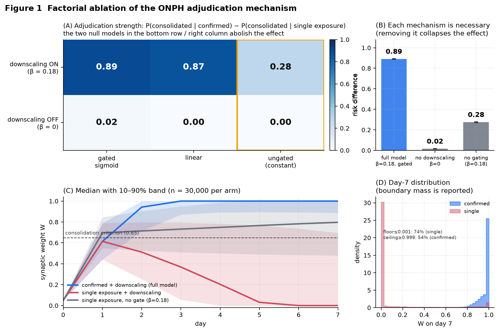
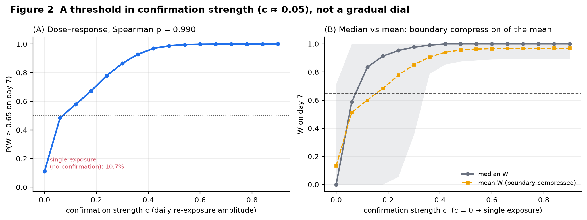
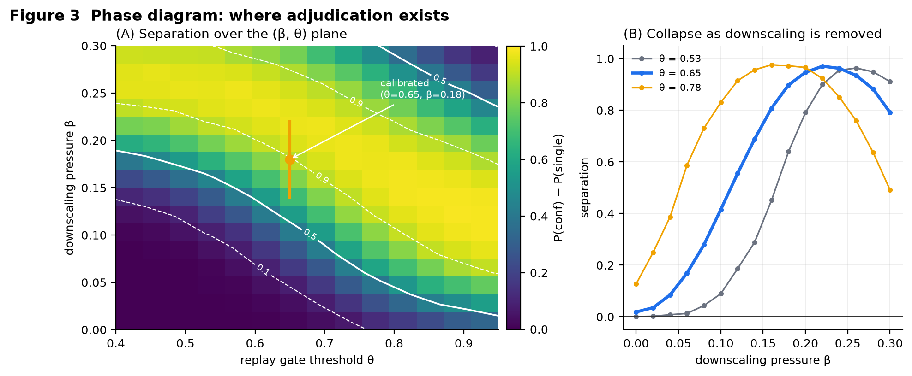
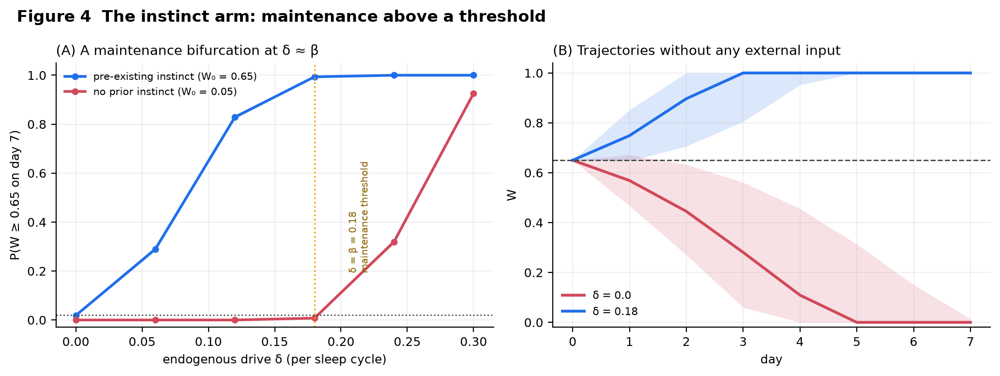
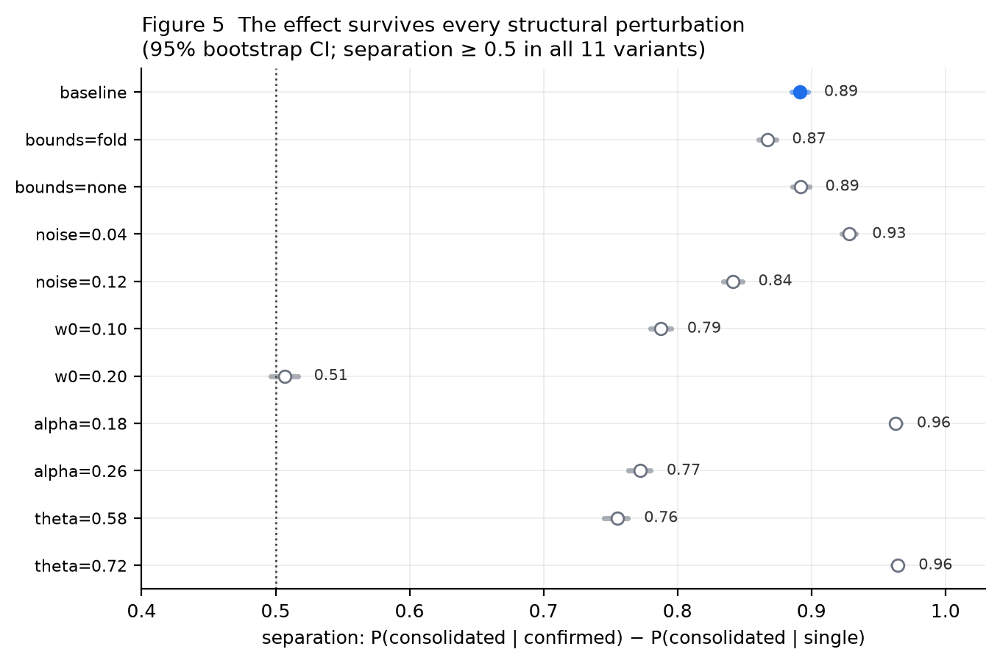

# Sleep as an Evolutionary Solution to the Plasticity–Stability Dilemma: A Unified Hypothesis of Bidirectional Memory Adjudication and Instinctual Maintenance

**Li Ning**

Version 2.0 · November 2026 · Theoretical and computational study

---

## Abstract

Sleep research is split between two successful but partial accounts. The synaptic homeostasis hypothesis (SHY) describes a global, restorative downscaling of synaptic strength during sleep; active systems consolidation describes the selective replay and transfer of memory traces. Neither explains why consolidation is so selective, why instinct-like content appears in dreams of individuals with no relevant experience, or how genetically specified circuits survive decades of disuse in stimulus-poor environments. We propose the Offline Neural Plasticity Homeostasis hypothesis (ONPH), which treats sleep as an offline maintenance program with two adjudication channels. Ontogenetic memory follows a sleep–wake loop: sleep tags traces by salience, and only wake-phase behavioural or cognitive reuse triggers capture and stabilisation; unprotected tags decay and are removed by homeostatic pressure. Phylogenetic memory is protected by an endogenous drive during REM sleep that offsets downscaling in circuits with high innate weight. Dreaming is a by-product: endogenous signals that never receive wake confirmation are classified as noise and pruned, which accounts for both their bizarreness and their rapid forgetting.

We then do something the earlier statement of the hypothesis did not do: we formalise it as a discrete-time stochastic difference equation in which each named mechanism is an independent, switchable factor, and we test whether the model can fail. Five pre-registered experiment families (3,032,000 Monte Carlo trajectories, fixed seed) show that (i) the divergence between confirmed and unconfirmed traces depends on homeostatic downscaling and threshold-gated replay, not on the input schedule — removing downscaling collapses the separation from 0.892 to 0.016, and removing both mechanisms gives exactly zero; (ii) confirmation strength behaves as a threshold with a half-maximum near c ≈ 0.05 and a monotone dose–response (Spearman ρ = 0.990); (iii) the effect occupies a bounded window in downscaling pressure, peaking near β = 0.22 and collapsing at both ends; (iv) instinct maintenance requires an endogenous drive at least as large as downscaling pressure, with a threshold at δ ≈ β, and strong drive can bootstrap a weak trace; (v) eleven structural perturbations leave the separation at ≥ 0.507, the single substantial sensitivity being initial synaptic weight. Three claims of the earlier version are corrected or withdrawn. We are explicit about what this does not show: the numbers are model-generated with calibrated parameters, not biological measurements, and the model does not establish that sleep *is* such a system, only that a system obeying these rules *would* display the proposed dynamics.

**Keywords:** sleep function; memory consolidation; synaptic plasticity; instinct; evolutionary neurobiology; computational modelling; sleep disorders

---

## 1. Introduction

### 1.1 The plasticity–stability problem

A nervous system that learns must remain stable enough to preserve what it has learned. Unconstrained Hebbian plasticity produces two familiar failure modes. New experience overwrites old representations — catastrophic interference — and sustained experience-driven change can erode circuits that were specified before experience began, including circuits for breathing, escape and other species-typical action patterns. The opposite failure is equally serious: a system too stable to be modified cannot track a changing environment.

Sleep is the most conspicuous candidate solution to this trade-off. It is conserved across vertebrates and occupies a large fraction of life, yet it removes the animal from the environment for hours at a time, which is exactly when an unresponsive animal is most vulnerable. A behaviour with that cost profile is expected to do something that cannot be done while awake. The proposal developed here is that sleep exists because some operations on synaptic weights are incompatible with online learning: they require a period in which external input is largely absent, so that the system can compare traces against one another and against internal priors, and delete what does not survive the comparison.

Two theories have carried most of the empirical weight. SHY (Tononi and Cirelli, 2014) holds that wake learning saturates synaptic strength and that sleep restores the system by global downscaling, with benefits for signal-to-noise ratio, energy and cellular maintenance. Active systems consolidation (Diekelmann and Born, 2010; Rasch and Born, 2013) holds that hippocampal traces are replayed during slow-wave sleep and transferred to neocortex. Both are supported; both are incomplete in the same direction. SHY explains why global downscaling does not destroy memory by appealing to selectivity, but does not specify the selection rule. Consolidation theory explains replay and transfer, but treats sleep as sufficient for consolidation, leaving little causal work for what happens after waking.

### 1.2 Three unexplained phenomena

Three observations motivate the hypothesis.

**Selective retention.** Global downscaling should degrade strong and weak traces in proportion. Yet some weak, low-frequency memories persist for decades while more recent and more intense experiences vanish. Selection must therefore be based on something other than current strength, and that something must be read out during or after sleep.

**Instinct in the absence of experience.** Dreams contain predation, falling, pursuit and sexual content in people who have never performed the corresponding acts, and Jouvet's (1979) cats, with pontine lesions releasing atonia, execute organised hunting and attack sequences during REM sleep. These are not recollections. Something is driving complex, species-typical motor programs from inside.

**The cost of disuse.** If "neurons that fire together wire together" has the corollary that circuits which stop firing together weaken, then innate circuits that a modern animal never uses should decay. The evolutionary cost of a degraded escape or maternal circuit is severe. A maintenance mechanism must exist, and it must operate without external triggers.

### 1.3 What this paper does

The hypothesis was stated previously as a theoretical review, with a computational appendix built around three hand-written scenarios. That design had a defect that we take seriously: the scenarios were fixed before the simulation ran, so no outcome could contradict the hypothesis. A simulation that cannot fail is an illustration, not a test.

This version keeps the theory and rebuilds the computational part. Section 2 states the hypothesis as four rules. Section 3 turns the rules into a discrete-time stochastic difference equation in which each mechanism is an independent switch. Section 4 reports five experiment families with falsification conditions fixed in advance, and states which earlier claims survive and which do not. Section 5 discusses what the results mean, what they do not mean, and what would count as evidence for or against the hypothesis in a biological system.

A note on status. Everything in Section 4 is model output. The simulations test internal consistency and the consequences of the stated rules; they do not test the rules against brains. We return to this distinction repeatedly, because the earlier version blurred it.

---

## 2. The hypothesis

ONPH treats sleep as an offline maintenance program executed on synaptic weights in four steps. The steps are meant as the algorithm, not as a metaphor: each is implemented as an operation on a weight variable, and each can be removed.

### 2.1 Rule 1 — Sleep tags by salience

During NREM sleep, hippocampal sharp-wave ripples couple with cortical slow oscillations and spindles, and traces are reactivated. The reactivation is not uniform: emotional salience, indexed by amygdalar and mesolimbic modulation, biases which traces are replayed and which receive a molecular tag. On the synaptic tagging and capture account of Frey and Morris (1997), early-phase potentiation installs a transient tag that only becomes stable late-phase potentiation if plasticity-related proteins are captured within a window of hours. ONPH extends the tag from the synapse to the sleep–wake cycle: the sleep phase, with its low interference and specific neuromodulatory background, is when tags are written; the wake phase is when capture is decided.

A tag is therefore a provisional status, not a memory. It grants a trace the right to compete for stabilisation and nothing more.

### 2.2 Rule 2 — Wake confirmation is the capture signal

A tagged trace is stabilised only if, after waking, the circuit is reactivated — by behavioural reuse, re-exposure, or deliberate recall. Confirmation typically occurs under attention and motivation, and the associated pulsed release of acetylcholine, noradrenaline and dopamine is the natural candidate for the capture instruction that routes proteins to tagged sites, converting early into late potentiation and producing durable structural change.

If no confirmation arrives within roughly one to two days, the tag decays. This is the point at which ONPH departs from consolidation theory. Sleep does not consolidate; it nominates. Consolidation requires a wake-phase event that is, in principle, observable and manipulable.

The rule also gives a natural account of the spacing effect. Distributed practice permits several sleep–tag–wake–confirm cycles on the same trace, each adding a layer of stabilisation; massed practice produces one.

### 2.3 Rule 3 — Homeostatic downscaling executes the decision

Global downscaling is retained from SHY, but its role changes. It is not the selector; it is the executor. Unconfirmed and therefore untagged traces are the weak, unprotected population, and global downscaling removes them preferentially because there is nothing holding them up. Confirmed traces survive because capture has made them strong enough to absorb the same proportional reduction.

Forgetting is thus active and functional: the default fate of an unconfirmed trace is deletion, and the metabolic argument for downscaling and the cognitive argument for selectivity turn out to be the same operation seen from two sides. This resolves the apparent paradox of selective retention under global scaling without requiring a second, separate selection mechanism.

### 2.4 Rule 4 — Endogenous drive protects phylogenetic memory

Rules 1–3 are a use-it-or-lose-it system, and therefore a threat to innate circuits. ONPH proposes that REM sleep supplies the missing input. Ponto-geniculo-occipital waves and brainstem pattern generators activate species-typical motor programs from inside, while muscle atonia keeps the output offline. Circuits with high innate weight — respiratory rhythm near the ceiling, complex predatory sequences lower — receive periodic driven activation that offsets downscaling, so the circuit never enters the unprotected, disuse-decaying state.

The developmental evidence is consistent with this reading: fetuses and neonates spend a very high proportion of sleep in REM, at a time when external input is minimal and the circuits being assembled are the ones that must work at birth; adolescent sexual dreams appear before the corresponding experience; and the proportion of REM rises across species whose instincts require postnatal refinement.

### 2.5 The by-product: dreaming

If REM drives instinct circuits and NREM drives memory replay, both at high intensity, then localised activity will spill into adjacent associative cortex while prefrontal reality-testing is suppressed. The posterior "interpreter" will narrate the result. Dream content therefore reflects which circuits were being maintained — falling for vestibular calibration, pursuit for predatory sequences, anxiety for emotional memory — but the specific plot carries no privileged symbolic meaning.

Dreams are also, by construction, unconfirmed: we do not act them out, and waking experience rarely matches them. Under Rule 2 they should be tagged, fail confirmation, and be pruned. This predicts the two most reliable facts about dreams, their bizarreness and their forgetting, from the same mechanism that explains the selectivity of real memory.

### 2.6 Relation to existing theory

ONPH is a two-channel version of the same economy. SHY's global downscaling is kept as the background process. Consolidation theory's replay is kept but demoted from sufficient cause to nomination. What is added is the wake-phase confirmation gate between them, and a second channel in which innate weight replaces experience as the thing being protected. The hypothesis does not claim that sleep has only these functions; it claims that this pair of channels is what the offline window is for.

### 2.7 The formal statement

Writing W for the weight of a trace, the four rules give the original budget-style formalisation:

```
ΔW = α · R · S − β · D · (1 − I) + γ · C · S + δ · I · A_REM
```

with R replay strength, S tag state, D global downscaling pressure, C wake confirmation, I innate weight and A_REM endogenous REM drive. The equation is a summary, not a model: it says which terms exist, not what happens over days when they interact, saturate, and are bounded. Section 3 turns it into something that can be run and falsified.

---

## 3. Model

### 3.1 One day, one cycle

Time is discrete, one step per wake–sleep cycle. A single trace is followed for seven cycles. The weight W_t ∈ [0, 1] after cycle t is updated by a wake phase and a sleep phase:

```
u_t     = 0.9                              t = 1   (encoding)
        = c · exp(−0.2 (t − 1))            t ≥ 2   (confirmation strength c)

w_wake  = B( w_{t−1} + γ u_t )
g       = σ(κ (w_wake − θ))                replay gate
r_t     = g · N(0.9, 0.2)                  gated replay
s_t     = N(1.0, 0.05)                     downscaling

w_t     = B( w_wake + α r_t − β s_t + δ·I + N(0, 0.08) )
```

B is a boundary operator, hard clipping to [0, 1] by default. The wake input u_t is drawn from a normal truncated at zero, with standard deviation 0.10; truncation matters, because the earlier implementation drew from a normal and clipped the negative tail, which biased the mean drive upward by about 0.04 and made weak confirmation look stronger than it was.

The gate is the formal content of Rule 2 read through Rule 3. A trace whose wake weight exceeds θ receives replay proportional to how far it exceeds it; a trace below θ receives almost none and is then reduced by β. Replay is therefore not a reward for being confirmed — the model does not represent confirmation directly — but a threshold on the state that confirmation produces. Two control gates are used: a linear gate (g = w_wake) and no gate at all (g = 1, constant replay).

### 3.2 Four switches

The decisive change from the earlier version is that the mechanisms of Section 2 are independent arguments rather than fixed parts of a script:

| Rule | Mechanism | Switch | Default |
|---|---|---|---|
| 2 | Wake confirmation | confirmation strength c | 0.6 |
| 3 | Homeostatic downscaling | β | 0.18 |
| 2+3 | Threshold gating of replay | gating ∈ {sigmoid, linear, none} | sigmoid, θ = 0.65, κ = 12 |
| 4 | Endogenous instinct drive | δ (instinct arm only) | 0.18 |

Any subset can be turned off while the rest runs. This is what makes the model falsifiable in the only sense available to a simulation: it can produce the wrong answer. In the earlier version, the "forgetting" scenario removed confirmation from the input schedule but left downscaling and replay intact, so the comparison was between two input schedules, not between mechanisms. Here the comparison is between mechanisms with the input held fixed.

### 3.3 Parameters and initial conditions

Replay gain α = 0.22, downscaling β = 0.18, wake gain γ = 0.70, endogenous drive δ = 0.18, noise 0.08, gate threshold 0.65, gate steepness 12, replay mean 0.9 (SD 0.2), downscaling mean 1.0 (SD 0.05), confirmation decay 0.2 per day. These are close to, but not identical with, the v1 specification (α 0.20, γ 0.65, δ 0.15); the differences fall inside the ranges explored in E3 and E5, and no result reported below depends on them.

All arms start at the same weight, W₀ = 0.05, including the instinct arm. This is a substantive correction: the earlier version started the instinct arm at 0.6 and the memory arms near zero, so "instinct" differed from "memory" in its initial value as well as in its mechanism. Any comparison between them was confounded, and the confound is now removed.

### 3.4 What the model is not

The model has one trace. It has no network, no hippocampus, no cortex, no sleep stages, and no plasticity budget: the constraint Σ|ΔW| ≤ B_total of the original formalisation is not implemented, so competition between traces — and therefore the budget-competition prediction of the earlier paper — remains untested. Parameters are calibrated to place the system in a regime with a clear signal-to-noise separation, not fitted to data. The model is a consistency check on a mechanism, not a simulation of a brain, and Section 4.7 lists what follows from that.

---

## 4. Computational results

### 4.1 Design, endpoint, falsification conditions

Five experiment families were specified before the runs, together with the outcome that would refute the corresponding claim. The seed is fixed (2026) and the full suite is bit-identical on re-run.

The primary endpoint is P(W_day7 ≥ 0.65), a binary outcome that is robust to the clipping of W at the boundaries. Group contrasts are risk differences with bootstrap confidence intervals, reported with Cohen's d and histogram overlap. Monte Carlo replicates are not biological samples, so no ANOVA p-values are used as evidence; the earlier practice of applying an ANOVA to 30,000 pseudo-replicates is abandoned.

| Experiment | Question | Falsified if |
|---|---|---|
| E1 | Does separation come from the sleep mechanisms or from the input schedule? | separation survives with β = 0; or unconfirmed traces survive without the gate; or separation is zero with all mechanisms on |
| E2 | Is the response to confirmation graded or thresholded? | P(consolidated) is not monotone in c |
| E3 | Does the E1 result generalise across parameter space? | separation does not collapse as β → 0 |
| E4 | Is endogenous drive necessary to maintain an instinct? | a pre-existing instinct survives at δ = 0 |
| E5 | Do structural assumptions drive the result? | separation depends on boundary rule, noise, gains or θ |

Total: 3,032,000 trajectories in about ten seconds of single-core CPU time.

### 4.2 E1 — the separation belongs to the sleep mechanisms

Twelve arms: confirmation (present, absent) × downscaling (β = 0.18, 0) × gating (sigmoid, linear, none), N = 30,000 per arm. "Confirmation" means daily re-exposure on the c = 0.6 schedule; "single exposure" means encoding on day 1 and nothing after.

| β | gating | risk difference P(conf) − P(single) | 95% CI | Cohen's d | overlap |
|---|---|---|---|---|---|
| **0.18** | **sigmoid** | **0.892** | [0.888, 0.895] | 4.02 | 0.095 |
| 0.18 | linear | 0.866 | [0.862, 0.870] | 3.36 | 0.094 |
| 0.18 | none | 0.276 | [0.271, 0.281] | 1.39 | 0.434 |
| 0.00 | sigmoid | 0.016 | [0.015, 0.018] | 0.21 | 0.971 |
| 0.00 | linear | 0.000 | — | 0.04 | 0.996 |
| 0.00 | none | 0.000 | — | 0.01 | 0.997 |

The day-7 distributions behind the two extreme rows are worth stating separately, because the means hide the structure. With the full mechanism, mean weight is 0.966 (SD 0.056), median 1.000, P(≥ 0.65) = 0.999, and 53.9% of trajectories are pinned at the ceiling. The single-exposure arm with downscaling and gate gives mean 0.133, median 0.000, P(≥ 0.65) = 0.107, and 73.9% at the floor. The distribution is bimodal, not shifted: traces are either stabilised or deleted.

None of the three falsification conditions was triggered.

**Removing downscaling collapses the effect** from 0.892 to 0.016, with overlap rising to 0.97. The same input difference, with the same replay rule, produces essentially nothing when homeostatic pressure is absent. Whatever separates the arms is not the presence or absence of external input per se; it is what the sleep machinery does with the difference.

**Removing the gate lets the unconfirmed arm survive**: P(≥ 0.65) rises from 0.107 to 0.724 (risk difference 0.276). With constant replay, weak traces receive enough potentiation to stay above threshold, so downscaling no longer discriminates. Threshold selection, not replay as such, is the selective element.

**Removing both gives exactly zero** (0.000, CI [0, 0], d = 0.007). This is the null model, and it is the control the earlier version lacked: an input difference alone, with no sleep mechanism, produces no divergence whatsoever.



**Figure 1.** Factorial ablation. Day-7 distributions for the twelve arms; the separation is carried by downscaling and gating, not by the input schedule.

Two further readings of this table matter. First, the linear gate reproduces most of the effect (0.866), so the result does not depend on the particular sigmoid; what matters is that replay is proportional to the wake state rather than constant. Second, the sigmoid arm differs from the gate-free arm by 0.616 in risk difference, while the β manipulation moves it by 0.876. Under this parameterisation, downscaling is the stronger of the two necessary conditions, and gating is the one that supplies selectivity. Both statements are model statements, not measurements.

### 4.3 E2 — confirmation behaves as a threshold, not a dial

Sixteen levels of c over [0, 0.9], N = 20,000 each. P(≥ 0.65) at selected levels:

| c | 0 | 0.06 | 0.12 | 0.18 | 0.24 | 0.30 | 0.42 | ≥ 0.54 |
|---|---|---|---|---|---|---|---|---|
| P(≥ 0.65) | 0.110 | 0.485 | 0.579 | 0.673 | 0.780 | 0.865 | 0.969 | 1.000 |

Spearman ρ = 0.990: the response is monotone, and the falsification condition was not met. The shape is the interesting part. With encoding and no confirmation at all, 11.0% of traces still survive — a floor set by noise and by the initial weight, not by the mechanism. By c = 0.06 the survival rate is 48.5%, and the half-maximum lies near c ≈ 0.05. From c = 0.3 upward the curve saturates.

Two consequences follow. The system is threshold-like in the sense that a small amount of confirmation moves a trace across a boundary rather than improving it gradually; and the calibrated operating point (c = 0.6) sits on the saturated plateau, so the model's qualitative behaviour is not balanced on a cliff edge. In the earlier version the opposite was true: modest parameter changes reversed the conclusion. That fragility was a property of the design, not of the hypothesis.



**Figure 2.** Dose–response for confirmation strength. Monotone, with a half-maximum near c ≈ 0.05 and saturation above c ≈ 0.3.

### 4.4 E3 — the effect occupies a finite window

A 16 × 14 grid over β ∈ [0, 0.30] and θ ∈ [0.40, 0.95], N = 4,000 per cell, 448 cells. 81% of cells show separation greater than 0.1 and 60% greater than 0.5, so the effect is not a point in parameter space.

Mean separation by β, averaged over θ:

| β | 0 | 0.06 | 0.10 | 0.14 | 0.18 | 0.22 | 0.26 | 0.30 |
|---|---|---|---|---|---|---|---|---|
| separation | 0.092 | 0.348 | 0.496 | 0.643 | 0.795 | **0.864** | 0.796 | 0.630 |

The lower bound reproduces E1: as β → 0 the mechanism has nothing to execute and separation vanishes. The upper bound is new and was not predicted by the earlier version. Above β ≈ 0.24, separation falls again, because excessive downscaling erodes confirmed traces along with unconfirmed ones. The hypothesis therefore does not imply "more downscaling is better"; it implies a window, with a peak near β = 0.22 and a calibrated point (β = 0.18, θ = 0.65) at 0.898, inside the plateau rather than at an edge.

This is a genuine prediction rather than a post hoc accommodation, and it is testable in principle: a manipulation that raises sleep pressure far beyond the normal range should reduce, not improve, retention of confirmed material. We do not know of data that speak to it.



**Figure 3.** Phase diagram in (β, θ). The upper bound on downscaling had no counterpart in the earlier formulation.

### 4.5 E4 — instinct maintenance has a threshold at δ ≈ β

No external input at all, not even on day 1: only endogenous drive. Two initial weights, six levels of δ, N = 10,000 each. P(≥ 0.65) on day 7:

| W₀ | δ = 0 | 0.06 | 0.12 | 0.18 | 0.24 | 0.30 |
|---|---|---|---|---|---|---|
| **0.65** (pre-existing instinct) | 0.019 | 0.290 | 0.829 | **0.994** | 1.000 | 1.000 |
| **0.05** (no prior trace) | 0.000 | 0.000 | 0.000 | 0.008 | 0.320 | 0.926 |

At δ = 0 a pre-existing instinct survives in 1.9% of trajectories, and 89.5% are pinned at the floor: without endogenous drive, homeostatic downscaling erases an innate circuit that receives no external input. The falsification condition was not triggered. Maintenance begins near δ = β and is essentially complete by δ = 0.18.

The second row corrects a claim of the earlier version. That version stated that endogenous drive "maintains but never creates". At δ = 0.30, twice the calibrated value and above β, a trace starting at W₀ = 0.05 climbs past 0.65 in 92.6% of trajectories. The gate provides positive feedback: a trace that crosses θ receives replay, which raises it further, and above a critical drive the fixed point at zero becomes unstable. The accurate statement is that the instinct channel has an unstable fixed point — below it traces decay, above it they bootstrap. This is a stronger and more falsifiable claim than the original: if raising endogenous drive in vivo fails to rescue a weak but specified circuit, the model is wrong on this point.



**Figure 4.** Instinct arm with no external input. Maintenance threshold near δ ≈ β; above it, weak traces bootstrap.

### 4.6 E5 — structural assumptions do not drive the result

Eleven variants of the baseline (separation 0.892), varying boundary rule, noise, replay gain, gate threshold and initial weight, N = 10,000 per arm:

| Variant | separation | 95% CI |
|---|---|---|
| baseline | 0.891 | [0.885, 0.897] |
| reflecting boundary | 0.867 | [0.861, 0.874] |
| unbounded | 0.892 | [0.886, 0.898] |
| noise 0.04 / 0.12 | 0.928 / 0.841 | — |
| W₀ = 0.10 / 0.20 | 0.787 / **0.507** | [0.497, 0.517] |
| α = 0.18 / 0.26 | 0.963 / 0.772 | — |
| θ = 0.58 / 0.72 | 0.755 / 0.964 | — |

All eleven variants give separation ≥ 0.507. Boundary handling is nearly irrelevant, which matters because the endpoint was chosen to be robust to clipping; noise level and replay gain move the effect by less than 0.1; the gate threshold matters in the expected direction.

The one substantial sensitivity is the initial weight. Raising W₀ from 0.05 to 0.20 halves the effect (0.892 → 0.507), because traces that start high can survive on inertia even without confirmation. This is precisely the confound that the earlier single-scenario design could not detect, and it is reported rather than hidden. It also sharpens the biological claim: the mechanism discriminates best between traces that begin weak, which is where discrimination is needed.



**Figure 5.** Robustness across eleven structural variants.

### 4.7 What these results do and do not show

They show that the rules of Section 2, implemented as stated, are jointly sufficient to produce a sharp and bounded divergence between confirmed and unconfirmed traces, that each of the three memory mechanisms is individually necessary for that divergence under this parameterisation, and that the instinct channel has the threshold structure claimed. They show that these conclusions are stable under changes to boundary conditions, noise, gains and gate threshold, and that they have one real vulnerability, the initial weight.

They do not show that sleep is a bidirectional adjudication system. They do not show that any biological parameter takes the values used here. They do not exclude other mechanisms that produce the same dynamics — an equivalent result could be obtained by a model with no gate at all but a different noise structure, and we have not searched that space exhaustively. And they say nothing about the network, the hippocampus, or the stages of sleep, none of which the model contains.

One earlier claim is withdrawn outright: the v1 statement that the simulation "verifies" the hypothesis. A simulation can verify that a mechanism is sufficient and internally consistent. It cannot verify that the mechanism is the one nature uses.

---

## 5. Discussion

### 5.1 What the model adds to the hypothesis

The four rules were previously a verbal argument with an illustration attached. They are now a dynamical system whose consequences can be computed, and three of those consequences were not obvious from the verbal statement.

The first is the asymmetry between downscaling and gating. Downscaling is necessary — without it the input difference produces nothing — but it is not selective; constant replay plus downscaling still leaves 72% of unconfirmed traces alive. Selectivity comes from the threshold. This is a precise version of the claim that SHY and consolidation theory are complementary: SHY supplies the pressure, the gate supplies the discrimination, and neither alone reproduces the phenomenon.

The second is the upper bound on downscaling. The verbal hypothesis says sleep prunes; it does not say how much. The model says there is an optimum and that overshooting it destroys confirmed memory. That is the kind of statement a theory of sleep ought to make and rarely does.

The third is the instability of the instinct channel. "Maintains but never creates" was a reasonable verbal hedge; the dynamics do not support it. A driven circuit with a threshold gate either decays to zero or bootstraps, and which one happens depends on whether drive exceeds downscaling pressure. This converts a vague protective function into a threshold prediction.

### 5.2 Clinical readings, stated conditionally

The earlier version derived two interventions from the hypothesis. The model does not test them, and they should be read as consequences of the rules rather than as validated treatments.

If confirmation is the capture signal, then a memory that is never reactivated after sleep should be lost even if sleep is undisturbed. This is the cleanest experimental implication of the framework, and it is testable with existing tools: tag a memory, sleep, then block its reactivation during the wake window (behavioural restriction, or chemogenetic inhibition of the engram), and ask whether the sleep-dependent gain disappears. The prediction is that it does.

If REM supplies endogenous drive to innate circuits, then selective REM deprivation during a critical period should degrade species-typical behaviour in adulthood while leaving simple learned skills relatively intact. This is an old question with a contested literature; the model's contribution is a quantitative threshold — drive must exceed downscaling pressure — which predicts that partial deprivation may be tolerated and that the deficit should appear as a threshold rather than a gradient.

The insomnia and PTSD readings of the earlier paper are consistent with the framework but are not derived from it. Treating insomnia as a misjudged safety state, or PTSD nightmares as a non-converging simulation loop, are interpretive moves; the model contains neither a safety monitor nor an emotional valence term. We keep them as hypotheses about how the rules might be instantiated clinically, not as results.

### 5.3 Engineering analogue

The model is a continual-learning architecture with an offline phase: freeze input, replay what is gated by current strength, apply a global weight reduction, and let a threshold decide what survives. This is close to existing ideas in machine learning — experience replay, elastic weight consolidation, sleep-inspired consolidation — and the simulation suggests where the sensitivity lies: the interaction between the global reduction and the replay threshold, and the initial weight of the representation, which in a network corresponds to pretraining. We make no claim of novelty here.

### 5.4 Limitations

Four limitations are serious enough to state plainly.

**No empirical test.** Every number in Section 4 is a Monte Carlo trajectory. The parameters are calibrated, not fitted, and calibration was done to place the system in a regime with clear separation. The agreement between model and hypothesis is therefore guaranteed by construction; what is not guaranteed is that the system can fail, and E1–E5 are designed to check exactly that. They succeed at that task. They do not constitute evidence about brains.

**One trace, no budget.** The plasticity-budget constraint is absent, so the prediction that daytime learning competes with instinct maintenance is untested. A multi-trace model with a shared budget is the natural next step and is where the hypothesis is most likely to break: if competition is added, the instinct channel's threshold may move.

**Equivalent mechanisms not excluded.** A different architecture — for example, one with no explicit gate but strong noise-driven bistability — could produce the same separation. The simulations establish sufficiency, not necessity in the space of all possible models.

**Parameter provenance.** β = 0.18, α = 0.22 and δ = 0.18 are chosen to satisfy the qualitative constraints of the theory (replay must be able to overcome downscaling; drive must be near β). They are not estimates. The phase diagram in E3 shows the results hold over a region, which is the best available substitute for knowing the true values.

### 5.5 What would count as evidence

The framework makes four predictions that are not restatements of the model. (i) Blocking post-sleep reactivation should abolish the consolidation benefit of sleep, without abolishing sleep itself. (ii) Increasing homeostatic pressure beyond the normal range should reduce retention of confirmed memories — the upper bound of E3. (iii) Selective REM deprivation in development should produce a threshold-shaped deficit in species-typical behaviour. (iv) Raising endogenous drive should rescue a weak but specified circuit, and lowering it should erase a strong one. Each is falsifiable with current techniques, and each is independent of the parameter values used here.

---

## 6. Methods

### 6.1 Simulation

The model is implemented in Python 3.10 with NumPy. One iteration corresponds to one wake–sleep cycle; the trace is followed for seven cycles. Wake input on day 1 is fixed at 0.9 (encoding); from day 2 the mean is c·exp(−0.2(t−1)), drawn from a normal truncated at zero with SD 0.10. The wake weight is bounded, then passed through the gate. Replay is g·N(0.9, 0.2); downscaling is N(1.0, 0.05); the weight is updated by α·replay − β·downscaling + δ·I + N(0, 0.08) and bounded. Boundary operator: hard clip by default, with reflecting fold and identity as robustness controls.

### 6.2 Experiments

E1: 2 (confirmation) × 2 (β) × 3 (gating), N = 30,000 per arm, 12 arms. E2: c over 16 levels in [0, 0.9], N = 20,000 each. E3: β × θ, 16 × 14 = 448 cells, N = 4,000 each. E4: W₀ ∈ {0.05, 0.65} × δ ∈ {0, 0.06, 0.12, 0.18, 0.24, 0.30}, no external input, N = 10,000 each. E5: 11 variants, 4 arms each, N = 10,000. Total 3,032,000 trajectories, seed 2026, runtime about 10 s on one laptop core, bit-identical on re-run.

### 6.3 Statistics

Primary endpoint P(W_day7 ≥ 0.65). Proportions are reported with Wilson intervals. Group contrasts use risk differences with 2,000-sample bootstrap percentile intervals, Cohen's d, and histogram overlap. Monotonicity in E2 is assessed with Spearman's ρ. No ANOVA and no p-values on replicate counts are used, because Monte Carlo replicates are not independent biological samples.

### 6.4 Reproducibility

Code, results and figures are archived with the manuscript. Running `python -m src.experiments` regenerates all tables; `python -m src.figures` regenerates Figures 1–5. All seeds are fixed.

---

## 7. Conclusion

The hypothesis is that sleep is an offline adjudication program with two channels: one that nominates ontogenetic memories for capture and executes the decision by global downscaling, and one that protects phylogenetic circuits by endogenous drive. This paper does not add evidence for that hypothesis. It removes a weakness in how the hypothesis was previously supported, by rebuilding the computational part so that it can fail, and it records what happened when it was allowed to.

Three claims survived. Downscaling and threshold gating, not the input schedule, carry the divergence between confirmed and unconfirmed traces, and each is necessary. The effect occupies a bounded region of parameter space. The instinct channel has a threshold at δ ≈ β. Three claims did not survive in their original form: the effect is not monotone in downscaling, endogenous drive can create as well as maintain, and the earlier simulation verified nothing it could not have been designed to confirm.

A theory that cannot fail is not yet a scientific theory. The value of this reconstruction is that the hypothesis now makes statements that could be wrong, and that the next round of experiments — biological ones — has something specific to test.

---

## Data and code availability

Model, experiments, figures and the full validation report (including the pre-registered falsification conditions) are archived with this manuscript. The archived v1 record carries a separate DOI; cite the version used.

## Author contributions

L.N. conceived the hypothesis, designed the computational reconstruction and wrote the manuscript.

## Competing interests

The author declares no competing interests.

## References

1. Tononi, G., & Cirelli, C. (2014). Sleep and the price of plasticity: from synaptic and cellular homeostasis to memory consolidation and integration. *Neuron*, 81(1), 12–34.
2. Diekelmann, S., & Born, J. (2010). The memory function of sleep. *Nature Reviews Neuroscience*, 11(2), 114–126.
3. Frey, U., & Morris, R. G. M. (1997). Synaptic tagging and long-term potentiation. *Nature*, 385(6616), 533–536.
4. Jouvet, M. (1979). What does a cat dream about? *Trends in Neurosciences*, 2, 280–282.
5. Stickgold, R., & Walker, M. P. (2013). Sleep-dependent memory triage: evolving generalization through selective processing. *Nature Neuroscience*, 16(2), 139–145.
6. Rasch, B., & Born, J. (2013). About sleep's role in memory. *Physiological Reviews*, 93(2), 681–766.
7. Hobson, J. A., & Friston, K. J. (2012). Waking and dreaming consciousness: neurobiological and functional considerations. *Progress in Neurobiology*, 98(1), 82–98.
8. Klinzing, J. G., Niethard, N., & Born, J. (2019). Mechanisms of systems memory consolidation during sleep. *Nature Neuroscience*, 22(10), 1598–1610.
9. de Vivo, L., Bellesi, M., Marshall, W., Bushong, E. A., Ellisman, M. H., Tononi, G., & Cirelli, C. (2017). Ultrastructural evidence for synaptic scaling across the wake/sleep cycle. *Science*, 355(6324), 507–510.
10. Diering, G. H., Nirujogi, R. S., Roth, R. H., Worley, P. F., Pandey, A., & Huganir, R. L. (2017). Homer1a drives homeostatic scaling-down of excitatory synapses during sleep. *Science*, 355(6324), 511–515.
11. Yang, G., Lai, C. S. W., Cichon, J., Ma, L., Li, W., & Gan, W.-B. (2014). Sleep promotes branch-specific formation of dendritic spines after learning. *Science*, 344(6188), 1173–1178.
12. Ngo, H.-V. V., Martinetz, T., Born, J., & Mölle, M. (2013). Auditory closed-loop stimulation of the sleep slow oscillation enhances memory. *Neuron*, 78(3), 545–553.
13. Wilson, E. B. (1927). Probable inference, the law of succession, and statistical inference. *Journal of the American Statistical Association*, 22(158), 209–212.
14. Efron, B., & Tibshirani, R. J. (1993). *An Introduction to the Bootstrap*. Chapman & Hall.
